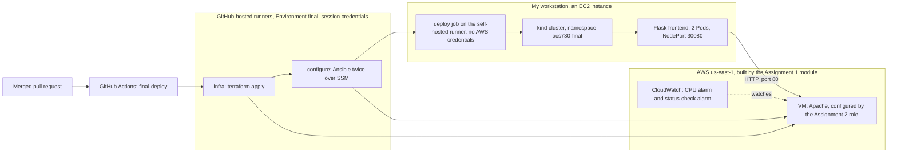

# Final Project - Two Services, Terraform, Ansible and Kubernetes, Deployed on Merge

**Report** - John Hui (GitHub `jhui26-seneca`), ACS730, November 2026. Repository: `jhui26-seneca/acs730-coursework`, folder `final-project/`. File-by-file details and scripts are in `README.md`; every claim below points to a file in `evidence/`.

## Introduction

The brief asks for six things at once: Terraform that reuses my Assignment 1 module and its multi-environment pattern, a configuration layer for whatever runs on a VM, Kubernetes deployed through the Week 9 and 10 self-hosted-runner pipeline for whatever is containerised, a deploy on every merge to `main` with no long-lived AWS credentials, at least one alarm on a real health signal, and a required security scan that stops a bad change before it can merge. Together they mean the application needs at least one piece on a VM and one in a container, and one has to depend on the other.

So the application is deliberately small. The backend is Apache on an EC2 VM, built by the Assignment 1 module and configured by the Assignment 2 role. The frontend is my Week 4 Flask app with one change: its home page calls the backend and quotes the answer. Everything else in the folder exists to build, connect, watch and prove those two pieces.

I first delivered the project on 12 November (PRs #44 to #46). The brief was updated on 11 November, and when I compared the two, my first version fell short in two places: its tfsec gate scanned only `lab8/`, so it couldn't block a change to this project, and its only alarm watched CPU load rather than health. So on 13 November I hardened the Assignment 1 module (PRs #47 and #48), pointed the required check at `final-project/terraform` as well (PR #50), proved it blocks a public port with a pull request built to fail (PR #51), and re-ran the whole deployment from a clean account (PR #52, run `43542051425`). Every file in `evidence/` comes from that re-run. The UTC timestamps in them read 14 November because I worked in the evening, Toronto time. Like everything this term, it ran in an AWS Academy Learner Lab, where IAM writes are denied and the budget is fixed. Both constraints come up again below.

## Architecture overview



The arrows are the only paths between the pieces. GitHub-hosted jobs reach AWS with session credentials and never touch the cluster. The self-hosted job reaches the cluster with a namespace-scoped ServiceAccount token and never touches AWS. The only traffic between the two services is the frontend's HTTP call to the VM on port 80. The required tfsec check (`lab8-policy.yml`) sits before all of this: it runs on the pull request, and the merge that starts this diagram can't happen until it passes.

## 1. What runs where, and why

**The frontend runs in a container on Kubernetes because it's stateless and it's the piece that changes.** It holds no data and no session, so any Pod can answer any request, and Kubernetes can replace, scale and roll it back without anyone noticing. It's also what a developer changes most often, and a rolling update with a readiness gate is the safest way I've seen this term to ship frequent changes: Lab 7's bad deploy never took the site down.

**The backend runs on a VM because it's the long-lived piece, and it's managed like a server.** Apache here stands in for the kind of dependency teams usually keep on VMs: a database, a legacy service, anything with its own operating system, packages and configuration files that someone has to patch and keep from drifting. That's exactly what Assignment 2's role was built for. It converges the server to a known state and proves it with `changed=0` on the next run. A Pod is the wrong shape for that, because it's meant to be thrown away and replaced, not converged.

The dependency runs one way: the frontend calls the backend. The Flask app reads `BACKEND_URL`, fetches the VM's page with a 3-second timeout, and returns `HTTP 200 from the VM: <the page's title>`. If the VM doesn't answer, `/` returns **502** with the error rather than a polite 200. A frontend that hides a broken dependency would make the integration look healthy when it isn't. `/healthz` checks only the Flask process, so a VM outage makes `/` fail loudly without Kubernetes pulling every Pod out of the Service.

## 2. Terraform: the Assignment 1 module, reused

`terraform/staging/main.tf` and `terraform/prod/main.tf` each call the module with one line: `source = "../../../assignment1/terraform/modules/web-env"`. `evidence/terraform-apply.txt` starts with that line, then the `init` and the apply: `Apply complete! Resources: 13 added`. That's a VPC, two public subnets, an internet gateway, a route table and its two associations, the security group and its two rules, the VM and two alarms, the same 13 resources each Assignment 1 environment now has.

The multi-environment pattern is unchanged: one module and one folder per environment, each with its own state key in the shared bucket. The callers differ only in what genuinely differs:

| | staging (applied) | prod (validated only) |
|---|---|---|
| State key | `final-project/staging/terraform.tfstate` | `final-project/prod/terraform.tfstate` |
| VPC | `10.40.0.0/16` | `10.50.0.0/16` |
| CPU alarm threshold | 70% | 60% |
| SSM parameter | `/acs730/assign1/final-staging/db_password` | `/acs730/assign1/final-prod/db_password` |

Only staging is applied: the budget doesn't stretch to two VMs, and nothing requires both. `final-ci` validates prod on every pull request and the required tfsec check scans it, so it can't quietly rot. I picked new network ranges rather than Assignment 1's, so the two projects could never collide.

The November changes went into the module, not into these callers. The root volume is now encrypted, every security group rule is its own resource, and a second alarm watches EC2 status checks. The callers picked all of it up through the `source` line, and their arguments didn't change. That's what a module is for.

Reusing a module had two costs, and I hit both on 12 November. The module builds its resource names from a fixed `acs730-assign1-<environment>` prefix, so the VM is called `acs730-assign1-staging-web`. The caller's `default_tags` (`Project=final`, `Role=web`) are what tell these resources apart, and they're what the Ansible inventory selects by. Second, my own validation rule from Assignment 1 rejected my first parameter name: `db_password_parameter_name must start with /acs730/assign1/`. Terraform stopped at plan time, before creating anything, and the fix was to use a name inside that prefix. Both are reasons a reusable module should take its naming as inputs, which I come back to at the end.

I applied staging from the workstation first, then let the pipeline own it. In the merge-triggered run, `infra` read the same state and printed `No changes. Your infrastructure matches the configuration.` (`evidence/pipeline-merge-deploy.txt`), so the pipeline and the workstation agree on one state file.

## 3. The configuration layer: the Assignment 2 role, in place

The role isn't copied. `ansible/ansible.cfg` sets `roles_path = ../../assignment2/ansible/roles`, so the play runs the same files Assignment 2 ran. The final project adds only its own inventory (running instances tagged `Role=web` and `Project=final`), its own SSM transfer bucket, and two play variables that change the page's title and message. Ansible reaches the VM over Systems Manager with no SSH key and no port 22.

`evidence/config-layer.txt` shows the whole change. Before Ansible, the page was the module's user_data output, `ACS730 assign1 - staging`. Run 1 reported `ok=6 changed=3`: the Apache settings file and the page were rewritten, and the settings change triggered the restart handler. httpd was already installed and running from user_data, so those two tasks were `ok`. Run 2, with nothing edited in between, reported `ok=5 changed=0 failed=0`. The page then read `ACS730 final project - backend`, and the `Server:` header showed `Apache` with no version, which is the role's settings template at work. In the pipeline, `configure` runs the play twice on every deploy and fails the job if the second run changes anything.

## 4. The design decision I'm defending: converge with Ansible after boot, not bake a golden AMI

The brief allows Ansible, a Packer golden AMI from Assignment 2, or both. I chose Ansible alone, and it was a real trade-off. Both tools were already built and both had worked for me.

**What a golden AMI would have given me.** A VM that's ready the moment it boots, identical to every other VM from the same image, and a rollback that's just "launch the previous AMI". No dependency on the SSM agent or a transfer bucket at deploy time, and no window where the server is half-configured. For a fleet behind an Auto Scaling group, those are decisive, and that's where I'd use one.

**Why I didn't, here.**

- **The module would fight the image.** The Assignment 1 module installs httpd and writes its own `index.html` in user_data at first boot. A baked page would be overwritten the moment the VM started, so Packer meant changing the module to skip its user_data for this caller. A converge runs after boot and simply wins.
- **Every change would replace the VM.** A new AMI means a new instance, which means a new public IP. That IP is what the frontend's ConfigMap points at, so every configuration change would ripple into the Kubernetes side. With Ansible, the VM and its address stay put, and a page change is applied in place.
- **Cost and cleanup.** Each Packer build leaves an AMI and its snapshot to pay for and to delete. The brief's cleanup rule names them specifically. With Ansible there's nothing extra to clean up.
- **Drift gets checked on every deploy.** Because `configure` runs the role twice and fails on any change in the second run, every merge doubles as a drift check on the server. An AMI only guarantees the state at launch.

**What it costs me.** The VM is mutable: someone with access could change it between deploys, and only the next run would notice. Configuration depends on SSM and S3 working at deploy time, and I wrote `wait-for-ssm.sh` because the agent isn't ready straight after a rebuild. It's also the slowest part of every deploy. In run 43542051425, `configure` took 1 minute 21 seconds of the 2 minutes 12, even though nothing on the server needed to change. I accepted that time to get a VM whose address and state are stable, and a drift check I get for free.

## 5. Kubernetes through the self-hosted runner pipeline

The cluster is the one-node kind cluster from Lab 7, still on the workstation. The final project has its own namespace, `acs730-final`, and its own deployment identity: ServiceAccount `acs730-final-deployer`, whose Role can `get`, `list`, `watch` and `patch` Deployments and `get` and `patch` ConfigMaps and Services in that namespace, and nothing else. The runner is Lab 7's, re-registered, running as its own Linux user, with a kubeconfig for that ServiceAccount and a 24-hour token. A person creates the objects once (`scripts/bootstrap-k8s.sh`), and the pipeline can only change them.

The `deploy` job follows Lab 7's shape:

1. It proves the job has no AWS credentials, then prints its cluster identity (`system:serviceaccount:acs730-final:acs730-final-deployer`).
2. It builds the frontend tagged with the first 12 characters of the commit SHA and `kind load`s it into the node.
3. With the Deployment paused, it generates the ConfigMap from the Terraform output, applies the Deployment and Service, and sets the new image. Then it resumes, so the whole change is one revision and `rollout undo` lands on the last good build.
4. `kubectl rollout status --timeout=120s` is the gate.
5. A smoke test requires `/` to return 200 **and** contain `HTTP 200 from the VM`. A frontend that's up but can't reach its backend fails the run.

The ConfigMap is generated rather than committed because it holds the VM's public address. That changes whenever Terraform rebuilds the VM, and IP addresses stay out of this repository. The address travels from the `infra` job's `web_url` output to the `deploy` job, which writes it into the ConfigMap on every run.

One constraint shaped this part. Lab 7's `kind-cluster.yaml` maps exactly one NodePort, 30080, to the workstation, and changing that means rebuilding the cluster. So `bootstrap-k8s.sh` removes Lab 7's Service and scales Lab 7's Deployment to 0, and `teardown.sh` puts both back. `teardown.txt` ends with Lab 7 answering on 30080 again.

`evidence/kubectl-get-all.txt` shows the result of run 43542051425: the node `Ready`, Deployment `2/2` on `acs730-final-web:fa8ef4066fdb` (the merge commit is `fa8ef4066fdb...`), two Pods and two endpoints behind the Service.

## 6. Deployed on every merge to main, with no long-lived AWS credentials

**The trigger.** `final-deploy.yml` runs on `push` to `main` only, filtered to the folders that change what's deployed. It has no `pull_request` trigger, because a fork's code must never reach a runner on my workstation, and no `workflow_dispatch`, because the deploy has to come from a merge. On this repository a push to `main` is a merged pull request, because branch protection requires Lab 4's `summary` and Lab 8's `tfsec (HIGH and above)` checks. `evidence/pipeline-merge-deploy.txt` ties it together. PR #52 was merged at 01:41:00 UTC with merge commit `fa8ef4066fdb`. Run 43542051425 started three seconds later with `event: push`, `branch: main` and that same SHA. It finished green at 01:43:15: `infra` 23 s, `configure` 1 min 21 s, `deploy` 18 s. That's 2 minutes 15 seconds from merge to a verified rollout, with no manual step in any job. Before trusting it I counted the deploy job's steps, all nine of them, for the reason at the end of this section.

**The credentials** (`evidence/credential-model.txt`):

- **Where they live.** The AWS secrets exist only on GitHub Environment `final`, and there are none at repository level. `final` has no required reviewer, because an approval would be a human step inside the merge run. It does have a deployment branch policy that allows only `main`.
- **Who uses them.** Only `infra` and `configure` declare that environment. Inside the run, both print `assumed-role/voclabs/<session>` (I mask the session name, which carries my Seneca login), and the action shows each key as `***`.
- **The job that touches the cluster has no AWS access at all.** `deploy` prints "No AWS credentials on the self-hosted runner", and it would fail the job if it found any, because the runner's user is blocked from the instance metadata service by the iptables rule from Lab 7. Its only credential is the ServiceAccount token.
- **How long they live.** The AWS credentials are Academy session credentials, pushed by `refresh-gha-creds.sh` at the start of the session and dead when the session ends. The cluster token lasts 24 hours.
- **Nothing long-lived in the repository.** gitleaks over every commit on every branch exits 0.

**The choice the brief asks me to defend: session credentials, not the runner's instance profile.** The brief offers two ways for the Terraform-provisioned pieces to reach AWS. One is session-scoped Academy credentials refreshed by `refresh-gha-creds.sh`. The other is the self-hosted runner's instance profile, which on my workstation is `LabRole` (`evidence/caller-identity.png`). I chose the session credentials, and I went further: the runner can't use the instance profile at all. On kind, the cluster isn't an AWS resource, so the runner reaches it with a kubeconfig, not with the instance profile. That left me free to cut the runner off from AWS completely.

The instance profile has one real advantage, and I took it seriously: nothing would be stored in GitHub, and there'd be no refresh step to forget. Against it:

- **Who can use it.** An instance profile belongs to the machine. Any process on the workstation can reach it, including any step of any job the runner picks up. The `deploy` job runs `docker build`, which pulls a base image and installs Python packages from the internet; with the instance profile reachable, one bad dependency would have the same AWS access as my Terraform. The session credentials sit in an environment that GitHub only hands to a job declaring `environment: final`, and only from `main`.
- **How long it lasts.** The instance profile's credentials are refreshed for as long as the instance runs. The session credentials die with the lab session, a few hours at most.
- **Where the work runs.** Using the instance profile would move Terraform and Ansible onto my workstation's runner, next to the cluster and next to my admin shell, so one compromised job could reach both AWS and Kubernetes. Keeping them on GitHub-hosted runners keeps each job to one kind of access.

What it costs me is the refresh. If I start a session and forget `refresh-gha-creds.sh`, the next merge fails at its first AWS step with an expired token. That's a loud failure, which I'd rather have than a quiet standing permission. In a real account I'd use neither: OIDC, with the trust policy from my Assignment 1 report scoped to `sub = repo:jhui26-seneca/acs730-coursework:environment:final`, and no stored keys at all.

**The first run on 12 November, and why it's still in this report.** Run 43276314354, from merging #44, went green in 8 seconds of `deploy`, and that was wrong. My first paste of `final-deploy.yml` had been cut off after the `kubectl apply` line. The run paused the Deployment, applied the manifests and stopped: no `set image`, no `resume`, no gate, no smoke test. Every step that did run succeeded, so the run was green, and the Deployment sat paused on the bootstrap image. I found it by reading the step list, not the colour, and fixed the workflow in PR #45. The lesson is the one Lab 7 taught from the other side: a deploy with no gate looks exactly as green as one with a gate, so I now count the steps before I trust a run.

## 7. Monitoring: a load signal and a health signal

The module now creates two CloudWatch alarms on the VM, and both are on signals that come from the running system, not from Terraform's idea of it:

| Alarm | Metric | Fires when | What it means |
|---|---|---|---|
| `acs730-assign1-staging-cpu-alarm` | `AWS/EC2 CPUUtilization`, Average | above 70% for 3 periods of 60 s | The VM is overloaded and the frontend's calls will start to time out |
| `acs730-assign1-staging-status-alarm` | `AWS/EC2 StatusCheckFailed`, Maximum | above 0 for 3 periods of 60 s | The VM's operating system or the host under it has failed AWS's checks: the backend is down, whatever Terraform's state says |

The CPU alarm is the one my first version had. It's a load signal, and a VM that has crashed doesn't use any CPU, so on its own it can't tell "idle" from "dead". `StatusCheckFailed` is the health signal: it goes to 1 when the instance stops answering or its host fails. Both use `treat_missing_data = missing`, so an alarm with no data shows `INSUFFICIENT_DATA` rather than a reassuring `OK`.

`evidence/monitoring.txt` was captured straight after run 43542051425, by the same script as the deployment evidence, so it describes the same system. Both alarms were `OK`: the CPU alarm since 01:36:54 UTC and the status alarm since 01:41:28, once the VM's first status checks were in. The metrics below the table are the live signal the alarms evaluate. CPU peaked at 9.7%, a long way under 70%, and every `StatusCheckFailed` datapoint was `0.0`. There are 9 CPU datapoints and 3 status ones rather than 15 of each, because the VM was only about ten minutes old and EC2 starts reporting status checks a few minutes after boot. The file ends with the frontend answering `HTTP 200` at the same moment, so the alarms, the metrics and the application all agree.

There's a second health check that isn't CloudWatch: the pipeline's smoke test. It fails a deploy if the frontend can't get a 200 from the VM, so a backend that's down at deploy time stops the run, not just an alarm.

What's missing is a notification. Neither alarm has an action, so a state change is visible in the console and nowhere else. In a real account each would publish to an SNS topic with an email or chat subscription, and the status alarm could also trigger EC2's automatic recovery.

## 8. The required security scan, and the change it blocked

**The gate.** Branch protection on `main` requires the check `tfsec (HIGH and above)` from `lab8-policy.yml`. Since PR #50 that job has a second step, `tfsec final-project/terraform --minimum-severity HIGH --no-color`, which follows both callers into the Assignment 1 module. Any HIGH or CRITICAL finding makes tfsec exit 1, the job fails, and GitHub won't merge. There's no `soft_fail`, no `continue-on-error` and no `|| true`. The job has no `paths:` filter, which looks odd next to the brief's "scoped with paths: final-project/**", and it's on purpose: a required check with a paths filter never reports on pull requests that don't match, and those pull requests then wait for it forever. That trapped me in Lab 5. `final-ci` and `final-deploy` keep their paths filters, because neither is required.

**What the gate found, and what I did.** Scanned for the first time on 12 November, the module had seven findings, six of them HIGH or CRITICAL. I fixed one and accepted three by design:

| Finding | Severity | Decision |
|---|---|---|
| `aws-ec2-enable-at-rest-encryption` | HIGH | Fixed: the root volume is encrypted with the account's default EBS key. It costs nothing |
| `aws-ec2-no-public-ingress-sgr` | CRITICAL | Accepted on the `http_public` rule only. The frontend runs on my workstation, in a different VPC, so it reaches the VM over the internet on port 80 |
| `aws-ec2-no-public-egress-sgr` | CRITICAL | Accepted on the `all_out` rule. The SSM agent, `dnf` and Ansible's S3 transfers need outbound HTTPS to addresses with no fixed range, and nothing can open a connection in through an outbound rule |
| `aws-ec2-no-public-ip-subnet` | HIGH | Accepted on the subnets. The VM needs a public address to be reached, and a NAT gateway for private subnets would cost about $33 a month |
| `aws-ec2-require-vpc-flow-logs-for-all-vpcs` | MEDIUM | Left as a finding. It's below the gate, and the logs would add cost for traffic nobody reviews |

Each accepted finding has a `#tfsec:ignore` directly above the one resource it covers, with the reason, my name, the date and a review date above that. Accepting them safely meant changing the security group first. The old one built every rule inline with a `dynamic` block, so a suppression would have covered the whole group, including any port a caller added later. Now each rule is its own resource, and rules a caller passes in `ingress_rules` go to `extra_ingress`, which is never suppressed.

`evidence/tfsec-scan.txt` records the result three ways. The gate, run exactly as the required check runs it, reports `No problems detected!` and exits 0. Its summary says `ignored 16`, which isn't 16 suppressions: at `--minimum-severity HIGH`, tfsec also counts every result below HIGH as ignored. Each caller scanned at every severity shows the true picture: `6 passed, 4 ignored, 1 potential problem`. The 4 are the three suppressions, with the subnet one counted twice because there are two subnets. The 1 is the flow-logs finding.

**The change it blocked.** A gate I've only seen pass proves nothing, so PR #51 tried to make the project worse. It added one line to `terraform/staging/main.tf`, opening port 8080 to `0.0.0.0/0` through `ingress_rules`. Thirteen checks passed, including `final-ci`'s Terraform validation, because the change is perfectly valid Terraform. `tfsec (HIGH and above)` failed in 7 seconds with a CRITICAL `aws-ec2-no-public-ingress-sgr` on `extra_ingress`, reached `via staging/main.tf`, and GitHub reported the pull request as `BLOCKED` (`evidence/security-gate-blocked.txt` and `.png`). The suppression on `http_public` didn't hide it, which is exactly what splitting the rules was for. I closed the pull request without merging.

## 9. The two services, integrated

`evidence/app-response.txt` was captured in the same sitting as the Kubernetes evidence, after the pipeline's rollout. Through the NodePort, the frontend returns `HTTP/1.1 200 OK` with:

```
ACS730 final project frontend (Flask on Kubernetes) -- version fa8ef4066fdb
backend: HTTP 200 from the VM: ACS730 final project - backend
```

The first line is the build the merge produced; the second is the VM's page title, quoted by the frontend. Calling the VM directly returns the same `<h1>ACS730 final project - backend</h1>`, and the frontend's ConfigMap shows where the address came from: `BACKEND_URL = http://<vm-public-ip>`, written by run 43542051425. The path is real network traffic: a Pod on the kind node, out through the workstation's public address, to the VM's public address on port 80.

The 502 behaviour is tested rather than assumed. `app/tests/test_app.py` fakes the backend call and checks all four cases: a normal answer, a refused connection (502), no `BACKEND_URL` (500), and `/healthz` staying independent. `final-ci` runs those tests on every pull request.

## 10. In place of the live demo

The demo was dropped from the course, so this is where each thing it asked me to show can be found instead:

| The demo would have shown | Where it is |
|---|---|
| A real change, pushed | PR #52: the callers' new `status_alarm_name` output and the evidence script's monitoring section |
| The required checks running | PR #52 went green on every check, including `tfsec (HIGH and above)`; PR #51 shows the same check failing and blocking (`security-gate-blocked.txt`, `.png`) |
| The deployment happening automatically | `pipeline-merge-deploy.txt`: merge at 01:41:00, run started at 01:41:03 by `push` on `main`, green at 01:43:15 with no manual step |
| The monitoring signal reflecting the live system | `monitoring.txt`: both alarms `OK`, the metrics a minute at a time up to the capture, and the frontend's HTTP 200 at the same moment |
| A follow-up question on the design decision | Section 4, and the questions below |

## 11. Questions I'd expect to be asked

**What happens if the pipeline runs twice?** Nothing changes, and that's checked. Terraform reads the same state and reports `No changes`. Ansible converges a server that's already right and must report `changed=0`, or the job fails. The new image is tagged with the commit SHA, so a re-run of the same commit sets the image it already runs and Kubernetes doesn't start a new rollout. The concurrency group queues a second merge behind the first, rather than running two applies at once or cancelling one halfway.

**What if a bad image merges, and how do you roll back?** The gate catches it before anyone has to. In Lab 7 I merged a deliberately broken readiness probe: `rollout status` timed out after 120 s, the run went red, and because Kubernetes doesn't remove an old Pod until a new one is Ready, the old Pods kept answering 200 throughout. This pipeline has the same gate plus a stronger smoke test. An image that starts but can't reach the VM also fails the run, because `/` returns 502. Rolling back is two steps. `kubectl rollout undo` puts the cluster back on the last good build straight away, and the pause makes that exactly one revision back. Then a revert on `main` fixes the source of truth, so the next merge doesn't redeploy the bad change.

**What does this cost to run for a day, and what did you turn off?** Roughly $2.65 a day while it's up, at us-east-1 on-demand prices:

| Item | Per day |
|---|---|
| Workstation, t3.large (the cluster and the runner) | $2.00 |
| Backend VM, t3.micro | $0.25 |
| Two public IPv4 addresses | $0.24 |
| EBS (20 GB workstation, 8 GB VM) | $0.07 |
| Detailed monitoring and the two alarms | $0.07 |

Three-quarters of that is the workstation. I turned everything off the same evening: `teardown.sh` deleted the namespace, deregistered the runner, destroyed all 13 Terraform resources, and deleted the SSM parameter and the transfer bucket (`evidence/teardown.txt`, every proof line empty, and `cleanup-check.sh` found nothing unexpected). There was no AMI or snapshot to delete, because I didn't bake one. Then the workstation was stopped. Left running all month it would be about $80, more than the whole $50 Academy budget, so in a real account I wouldn't run the cluster on a big always-on workstation at all.

**What would you do differently with a real AWS account?** The IAM-denied constraints shaped the identity half of this design, and almost none of the rest. With IAM I'd use OIDC with one role per environment and no stored keys. The runner wouldn't need an iptables rule to stop it borrowing an unscoped instance role; it would get no role at all, or a narrow one like the policy I wrote in Lab 8. The budget shaped the other half. I'd run the frontend on EKS or another managed cluster, with an ephemeral runner inside the VPC. The VM would sit in a private subnet that accepts port 80 only from the cluster's nodes, which would also remove two of the three findings I accepted. The image would be built once and pushed to ECR, not built on the runner and side-loaded into kind. And the alarms would notify someone.

## 12. What I'd do differently if I started over

**Secure the module from the first day, not the last week.** I wrote the Assignment 1 module in October and scanned it for the first time in November, when the final project needed a gate. Fixing the root volume was one line. Making the suppressions safe meant restructuring the security group, re-running every environment, and a LocalStack failure along the way (it wanted a volume size once `root_block_device` was set). Run tfsec from the first commit and that work disappears.

**Make modules take their names as inputs.** A `name_prefix` variable would have given the final project `acs730-final-staging-*` names instead of borrowing Assignment 1's, and a parameter-path input would have avoided the validation error.

**Make every check that guards a merge a required one.** On 13 November I merged PR #47 while its LocalStack check was red, because that check isn't required and the merge button let me. The fix came in PR #48 soon after, but the lesson stuck: a check you can merge past is advice, not a gate. Here that's why I put the new scan in the already-required tfsec job rather than in a new, optional one.

**Write workflows as files and copy them across.** The truncated `final-deploy.yml` on 12 November came from pasting a long block into a terminal. Replacing each file whole and checking its line count and hash before committing, as I did for every file on 13 November, would have caught it before it ran.

## 13. Course retrospective

The concept I most want to go deeper on is Kubernetes, from Weeks 9 and 10. Everything I've done with it this term ran on a one-node kind cluster, reached through a single NodePort. I've written Deployments, readiness probes, RBAC and a rollout gate, and I've watched a bad rollout fail safely. But I've never seen Kubernetes do the thing it's for: move work off a node that dies. I haven't used an Ingress, an autoscaler or a managed cluster either, and the one-port limit of my kind setup shaped this whole project more than I expected.

My next step is to rebuild the Lab 7 cluster with three nodes, run this frontend across them, and stop a node to watch the Pods reschedule. After that, I want to run the same pipeline against a managed cluster in an account where I can create IAM roles, so the runner can reach it the way the brief describes and the OIDC design I've written twice can finally be built.

The habit I'll keep from this course is the one this project is made of: build a piece once, reuse it rather than copy it, and make every claim in a report point at a file that proves it.
